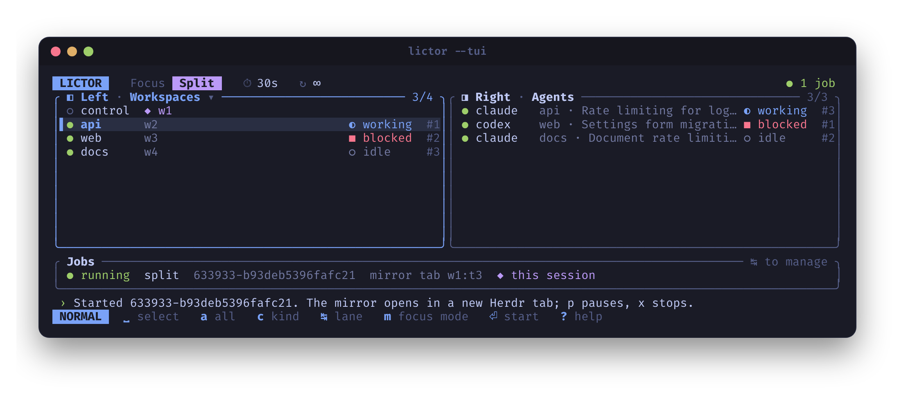
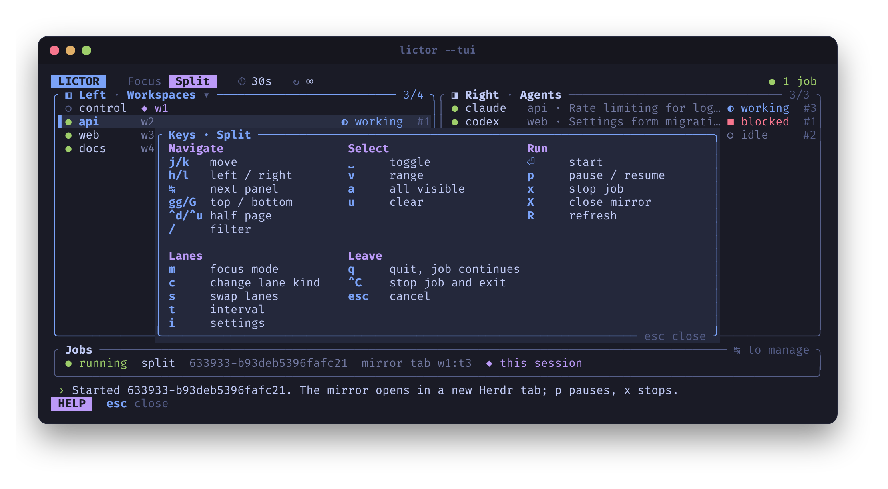
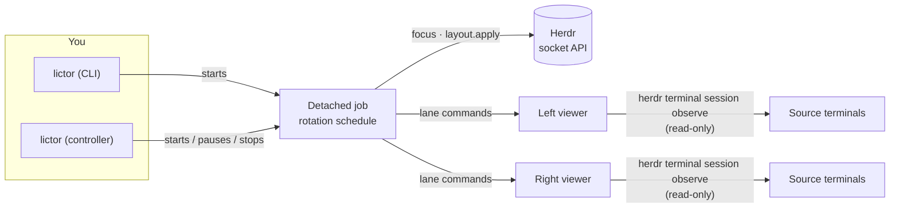

<div align="center">

# Lictor

**Keep an eye on every terminal and coding agent in [Herdr](https://herdr.dev/), without touching them.**

Rotate Herdr's focus through your workspaces, tabs, panes and agents, or open a live
split view that mirrors two rotating lanes side by side while the originals keep running.

[](https://github.com/SyscallBrain/lictor/actions/workflows/ci.yml)
[](https://syscallbrain.github.io/lictor/)
[](LICENSE)
[](https://www.rust-lang.org/)
[](#requirements)
[](https://herdr.dev/)
[](https://ratatui.rs/)


<sub>A Lictor mirror tab: the <code>api</code> workspace (agent and server log) on the left, a blocked agent waiting for permission on the right. Both lanes rotate on their own.</sub>

[Features](#features) ·
[Install](#installation) ·
[Quick start](#quick-start) ·
[The controller](#the-keyboard-controller) ·
[How it works](#how-it-works) ·
[Docs](https://syscallbrain.github.io/lictor/)

</div>

---

## Why Lictor?

When several coding agents work in parallel, the hard part is noticing which one has finished, is
stuck, or is waiting for you. Lictor turns Herdr into a dashboard you can glance at:

- **Focus rotation** moves Herdr's focus from target to target every few seconds, like a slideshow
  of your work.
- **Split observation** opens a new Herdr tab with two live, read-only mirrors. Each side cycles
  through its own list, for example every workspace on the left and every agent on the right.
  Nothing is moved, resized, restarted or typed into.

## Features

- 🔁 **Rotate anything:** workspaces, tabs, panes and recognized agents (Claude, Codex, …), mixed
  in any order, with repeat entries for extra dwell time and optional shuffling.
- 🪟 **Live split mirrors:** two independent lanes in one tab. Workspace and tab mirrors rebuild
  the whole source layout, pane by pane, with colors and full-screen apps intact.
- 🚦 **Status-aware:** `--status blocked,done` visits only the agents waiting for you, checked
  live at every step.
- ⌨️ **Keyboard controller:** a Vim-style TUI in the Tokyo Night theme. Pick targets, build the
  split, start, pause and stop jobs, all from one screen.
- 🧭 **Scriptable CLI:** everything the controller does is one command away, with dry runs and
  listings to check before you start.
- 🧩 **Managed jobs:** rotations run detached, survive closing the controller, and can be listed,
  paused, resumed or stopped from anywhere.
- 🛡️ **Safe by design:** mirrors observe terminals read-only. Lictor never sends input to your
  agents, never moves panes, and only closes tabs it created.

## Screenshots

<table>
  <tr>
    <td width="50%"></td>
    <td width="50%"></td>
  </tr>
  <tr>
    <td align="center"><sub><b>Split mode.</b> The two lanes, side by side as they will appear.</sub></td>
    <td align="center"><sub><b>Running.</b> The controller stays open to manage the job.</sub></td>
  </tr>
  <tr>
    <td width="50%"></td>
    <td width="50%"></td>
  </tr>
  <tr>
    <td align="center"><sub><b>Focus mode.</b> Pick targets of any kind, reorder the queue.</sub></td>
    <td align="center"><sub><b>Help.</b> Every key, grouped by purpose, for the current mode.</sub></td>
  </tr>
</table>

<details>
<summary><b>CLI help</b> (<code>lictor -h</code>)</summary>
<br>

</details>

## Requirements

| | |
| --- | --- |
| **OS** | Linux (macOS is planned; platform code is isolated) |
| **Herdr** | A running session; tested with Herdr **0.9.3**. Split mirrors also need the `herdr` command in `PATH`. |
| **Build** | Rust **1.88** or newer |
| **Optional** | `notify-send` for desktop notifications; `tmux` or X11 + `xdotool` for sidebar control |

Lictor talks to Herdr's socket API natively, so it doesn't need `jq`, Python or `socat`.

## Installation

From GitHub, with Cargo:

```bash
cargo install --git https://github.com/SyscallBrain/lictor --locked
```

Or from a clone:

```bash
git clone https://github.com/SyscallBrain/lictor
cd lictor
cargo install --path . --locked
```

Check that it can see your Herdr session:

```bash
lictor -W -l
```

## Quick start

```bash
# Open the keyboard controller
lictor

# Focus each workspace, then each agent, every 5 seconds
lictor -W -A -s 5

# New tab: workspaces mirrored on the left, agents on the right
lictor -W -A -s 5 -S w,a

# The same, reviewed in the controller first (press Enter to start)
lictor --tui -W -A -s 5 -S w,a

# Only visit agents that are blocked or done
lictor -A --status blocked,done

# Preview the plan without changing anything
lictor -W -A -d -n 8

# See and stop what is running
lictor --jobs
lictor --stop
```

Pick the lanes and their targets yourself:

```bash
lictor -S w,a --left-targets api,web --right-targets claude,codex
lictor -S t,a --left-targets api:1,web:2 --right-targets claude
```

When a rotation stops, its mirror tab stays open and live on the last targets. Close it with
`lictor --close-view`, or start with `--close-on-exit`.

## The keyboard controller

Run `lictor` with no arguments. The screen is a board of two panels that matches what will run:
the two lanes in split mode, or a target list and the rotation queue in focus mode.

| Key | Action | | Key | Action |
| --- | --- | --- | --- | --- |
| `j` `k` | Move | | `m` | Focus ⇄ split mode |
| `h` `l` / `Tab` | Switch panel or lane | | `c` | Change the lane's kind |
| `Space` | Select / deselect | | `s` | Swap the lanes |
| `v` | Select a range | | `t` | Set the interval |
| `a` / `u` | Select all / clear | | `i` | Settings |
| `/` | Filter | | `Enter` | **Start** |
| `J` `K` | Reorder the queue | | `p` / `x` / `X` | Pause · stop · close mirror |
| `?` | All keys | | `q` | Quit (jobs keep running) |

To build `lictor -W -A -s 5 -S w,a` by hand: `m` (split mode), `a` (all workspaces), `l` `a`
(all agents), `t` `5` `Enter` (interval), then `Enter` to start.

## How it works



1. **Resolve.** Lictor reads one Herdr snapshot and turns your flags and selectors into an ordered
   list of targets, identified by Herdr's IDs so a reorder never swaps one target for another.
2. **Hand off.** A detached job owns the schedule, so closing the controller or its terminal doesn't
   stop the rotation. The job registers itself and can be paused, resumed or stopped by ID.
3. **Focus rotation** asks Herdr to focus the next eligible target at every interval, rechecking
   that targets still exist and that agents match your status filter.
4. **Split observation** creates one new tab with `layout.apply` and runs a Lictor viewer in each
   half. At every tick the job tells each viewer what to show next. Viewers stream the source
   terminals with `herdr terminal session observe`, replay the ANSI output into virtual terminals,
   and draw them in the original pane layout.

Read [How Lictor works](https://syscallbrain.github.io/lictor/how-it-works.html) in the book for the full picture.

## Documentation

The **[Lictor book](https://syscallbrain.github.io/lictor/)** covers every option in depth:
[target selectors](https://syscallbrain.github.io/lictor/selectors.html),
[split observation](https://syscallbrain.github.io/lictor/split-observation.html),
[jobs](https://syscallbrain.github.io/lictor/jobs.html),
[agent status](https://syscallbrain.github.io/lictor/agent-status.html),
[troubleshooting](https://syscallbrain.github.io/lictor/troubleshooting.html) and the
[CLI reference](https://syscallbrain.github.io/lictor/cli.html). `lictor --help` has the details
for each option. To build the book locally:

```bash
cargo install mdbook --locked
mdbook serve --open
```

## Limitations

- Linux only for now.
- Mirrors are read-only by design. To type into an agent, switch to it in Herdr.
- A source that is bigger than its mirror is cropped, keeping the newest lines in view; the source
  terminal is never resized.
- Inline images (Kitty graphics) are not mirrored by the Herdr 0.9.3 observer.
- Sidebar control needs tmux or X11 with `xdotool`; it is optional.

## Contributing

Issues and pull requests are welcome. Read [CONTRIBUTING.md](CONTRIBUTING.md) first. In short:

```bash
cargo fmt --check
cargo clippy --all-targets --locked -- -D warnings
cargo test --locked
python3 tests/cli_acceptance.py target/release/lictor
python3 tests/controller_acceptance.py target/release/lictor
```

Tests use a fake Herdr socket. Live experiments belong in a disposable named session
(`herdr --session lictor-proof-…`), never your real one.

## Acknowledgements

- [Herdr](https://herdr.dev/), the terminal workspace manager Lictor is built for.
- [Ratatui](https://ratatui.rs/), [vt100](https://crates.io/crates/vt100), [clap](https://crates.io/crates/clap) and [Tokio](https://tokio.rs/).
- The [Tokyo Night](https://github.com/folke/tokyonight.nvim) color palette.
- Lictor started as a Rust port of the [`herdr_rotate`](https://gist.github.com/SyscallBrain/e6534601ece6d956e922c589f517078c) Bash script.

## License

[MIT](LICENSE) © 2026 Tiago Correia. Herdr is a separate project with its own license.
