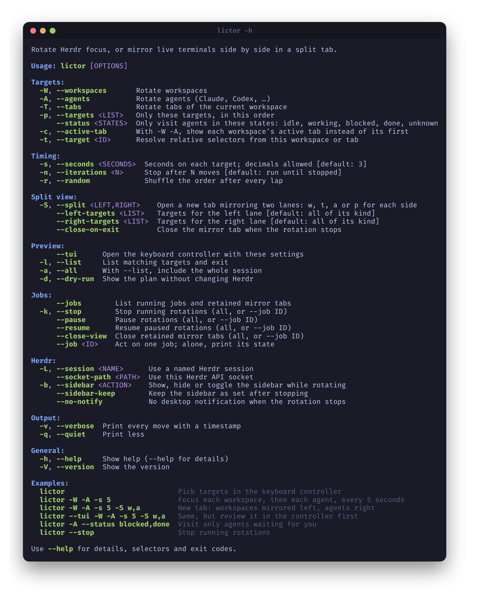

# CLI reference



`lictor -h` prints a compact summary; `lictor --help` adds details, selectors, more examples and exit codes. No arguments opens the TUI; with arguments Lictor runs directly, unless `--tui` is given to review them in the controller first.

```bash
lictor -W -A -s 5               # focus each workspace, then each agent, every 5 seconds
lictor -W -A -s 5 -S w,a        # new tab: workspaces mirrored left, agents right
lictor --tui -W -A -s 5 -S w,a  # same, reviewed in the controller first
lictor -A --status blocked,done # visit only agents waiting for you
lictor --jobs                   # running jobs and retained mirror tabs
lictor --stop                   # stop running rotations
```

## Targets

| Option | Meaning |
| --- | --- |
| `-W`, `--workspaces` | Rotate workspaces. |
| `-A`, `--agents` | Rotate recognized agents. |
| `-T`, `--tabs` | Rotate tabs of the current workspace. `-w`/`--windows` remain as hidden legacy aliases. |
| `-p`, `--targets LIST` | Only these targets, in this order; repeat one for extra dwell. `--panes` is an alias. |
| `--status STATES` | Only visit agents in these states (`idle`, `working`, `blocked`, `done`, `unknown`), checked live. Implies `-A`. |
| `-c`, `--active-tab` | With `-W -A`, show each workspace's active tab instead of its first. |
| `-t`, `--target ID` | Resolve relative selectors from this workspace, tab or pane. |

See [selectors](selectors.md) and [agent status](agent-status.md). Group flags may be combined; their order on the command line is the rotation order. When `-T` is mixed with `-W` or `-A`, prefix `-p` entries with their kind (`tab=`, `workspace=`, `agent=`, `pane=`).

## Timing

| Option | Meaning |
| --- | --- |
| `-s`, `--seconds SECONDS` | Seconds on each target; default 3; dot or comma decimals. `--interval` is an alias. |
| `-n`, `--iterations N` | Stop after N successful moves; 0 (default) runs until stopped. In split mode every lane advance counts. |
| `-r`, `--random` | Shuffle the order after every lap, keeping repeated entries. |

## Split view

| Option | Meaning |
| --- | --- |
| `-S`, `--split LEFT,RIGHT` | New tab with two live mirrors; one kind per lane: `w`, `t`, `a` or `p` (e.g. `w,a`). |
| `--left-targets LIST` | Targets for the left lane; default all of its kind. |
| `--right-targets LIST` | Targets for the right lane; default all of its kind. |
| `--close-on-exit` | Close the mirror tab when the rotation stops instead of leaving it live on the last targets. |

Split lane kinds imply their target groups; extra group flags must match a lane. `-p` does not select split lanes. See [split observation](split-observation.md).

## Preview

| Option | Meaning |
| --- | --- |
| `--tui` | Open the keyboard controller with these settings. |
| `-l`, `--list` | List matching targets and exit. |
| `-a`, `--all` | With `--list`, include the whole session. |
| `-d`, `--dry-run` | Show the targets and first steps (5, or `-n`) without changing Herdr. |

Listing and dry-run never focus targets or create tabs. Dry-run uses current agent states and cannot predict later changes.

## Jobs

| Option | Meaning |
| --- | --- |
| `--jobs` | List running jobs and retained mirror tabs. |
| `-k`, `--stop` | Stop running rotations. |
| `--pause`, `--resume` | Pause or resume rotations. |
| `--close-view` | Close retained mirror tabs. |
| `--job ID` | Act on one job with the options above; alone, print its state; with `--tui`, open the controller on it. |

Without `--job`, the actions apply to all of the current user's jobs. Use only one action at a time. See [jobs](jobs.md).

## Herdr

| Option | Meaning |
| --- | --- |
| `-L`, `--session NAME` | Use a named Herdr session. |
| `--socket-path PATH` | Use this Herdr API socket; exclusive with `--session`. |
| `-b`, `--sidebar ACTION` | `show`, `hide` or `toggle` the sidebar while rotating; restored on stop. |
| `--sidebar-keep` | Keep the sidebar as set after stopping. |
| `--no-notify` | No desktop notification when the rotation stops. |

See [sidebar controls](sidebar.md) for platform support.

## Output and general

| Option | Meaning |
| --- | --- |
| `-v`, `--verbose` | Print every move with a timestamp. |
| `-q`, `--quiet` | Print less. |
| `-h`, `--help` | Compact help; `--help` for details. |
| `-V`, `--version` | Show the version. |

Invalid combinations are rejected before anything changes, with a hint on how to fix them.

## Exit codes

| Code | Meaning |
| --- | --- |
| 0 | Success or clean stop. |
| 1 | General runtime failure. |
| 2 | Invalid arguments. |
| 3 | Missing targets, every target disappeared, or no job to control. |
| 4 | Herdr/server/socket unavailable. |
