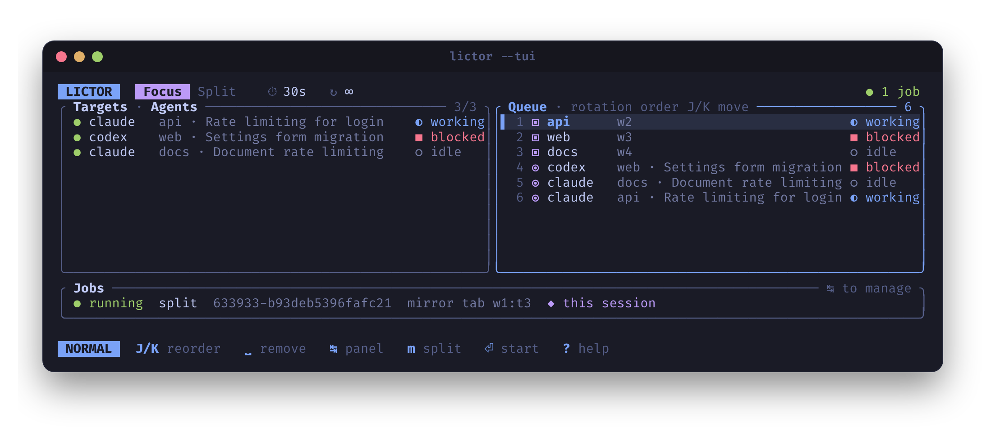

# Focus rotation

Focus rotation changes the target presented by Herdr. Focusing a pane in another tab or workspace also changes its containing tab/workspace.

```bash
lictor -p 1,2 -s 3
lictor -T -p 1,2,4 -s 5
lictor -W -s 10
lictor -A -s 5
```

To build the queue interactively, open the controller with `lictor`: pick targets of any kind on the left; the queue on the right is the rotation order, and `J`/`K` reorder it. See [the selection TUI](tui.md).



Without a group flag, targets are panes in the baseline tab. `-T` selects tabs, `-W` workspaces, and `-A` recognized agents. Group flags can be combined; the first occurrence of each group determines its position in the default queue.

The baseline context is fixed when the invocation starts. Index selectors resolve against that first snapshot, so later focus changes do not make `1` refer to a different target.

The first eligible target is selected immediately, then Lictor waits the configured interval. The default interval is three seconds. Both `-s 2.5` and `-s 2,5` mean two and a half seconds.

Use `-n` to finish after a bounded number of successful focus requests:

```bash
lictor -p 1,2 -s 2.5 -n 20
```

Zero means unlimited. Failed focus requests, removed targets, and agents skipped by a status filter do not consume the limit.

Repeated entries intentionally add dwell time:

```bash
lictor -p 1,1,2 -s 5
```

The first target receives two intervals before the second target. Random order keeps these repeated entries; the first lap follows your queue, and later laps are shuffled.

For compatibility with the Bash script, `-W -A` uses each workspace's first tab. Add `-c` to use its active tab instead. `-W` alone already uses the active tab. Workspace **mirrors** in split mode use active source tabs by default.

Before each visit, Lictor refreshes state. Removed targets leave the queue; if all disappear, rotation ends with exit code 3. New targets are not automatically selected. A pane moved to another workspace gets a new public ID and therefore leaves a queue that held its old ID.
