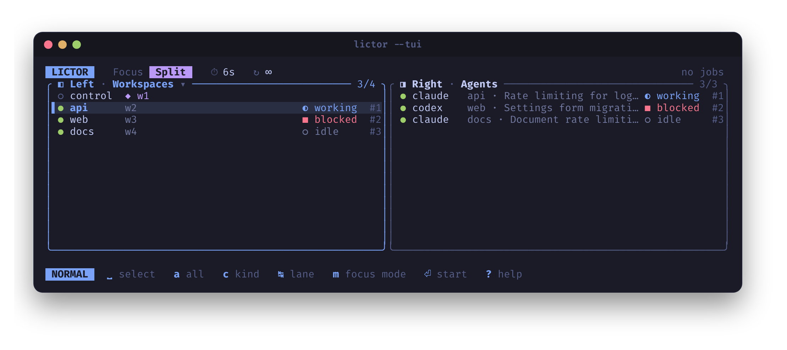

# Quick start

Inside a running Herdr session, open the selection interface:

```bash
lictor
```



Move with `j` and `k`, switch panels with `h` and `l`, and use Space to select targets; the queue fills on the right. Press `m` for split mode and `t` for the interval, then Enter to start. Press `?` for all keybindings.

For direct CLI use, list available agents, then rotate through them:

```bash
lictor -A -l
lictor -A -s 5
```

To alternate workspaces first and agents afterward:

```bash
lictor -W -A -s 5
```

Reverse the flags to put agents first. Tabs can be mixed into the sequence too:

```bash
lictor -A -W -T -s 5
```

Open a new tab with workspace views on the left and agent views on the right:

```bash
lictor -W -A -s 5 -S w,a
```

Both lanes advance every five seconds, each wrapping through its own queue. Workspace views show complete source tabs; the original terminals remain where they were.

To configure the same behavior in the TUI, press `m` for split mode (workspaces left, agents right), press `a` in each lane (`h`/`l` switches lanes) to select all its targets, set five seconds with `t`, then press Enter to start. `c` changes a lane's kind and `s` swaps the lanes, so any kind and order works. Alternatively, run `lictor --tui -W -A -s 5 -S w,a` and press Enter.

Preview a rotation without changing Herdr:

```bash
lictor -W -A -s 5 --dry-run -n 8
```

Stop active rotations from another shell or a Herdr shortcut:

```bash
lictor --stop
```

The split tab stays open on its last targets and continues showing their output. Add `--close-on-exit` when starting if you want that tab to close on completion or stop.

See [jobs](jobs.md) for controller handoff and cleanup, and [sessions](sessions.md) to select a named session or explicit socket.
