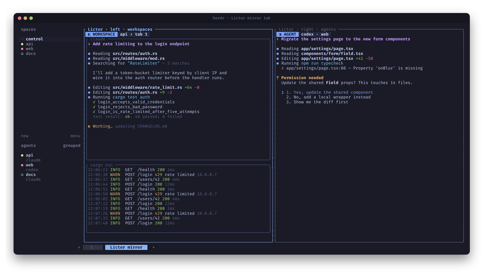

# Live split observation

Split observation creates a new Herdr tab with two real panes separated by a vertical divider. Viewer processes inside those panes observe existing terminals.

```bash
lictor -W -A -s 5 -S w,a
```

`w,a` means workspaces on the left and agents on the right. Both advance every five seconds. Each queue wraps independently, so one lane can repeat while the other is still on its first lap.



Lictor switches Herdr to the new tab as soon as both viewers are ready. Herdr labels the panes by lane (`Lictor · left · workspaces`); inside, each viewer has a header naming what it shows right now, such as `◧ WORKSPACE  api › tab 1` or `◨ AGENT  codex · web`, plus a `⚠` notice if a source closes or its stream fails. To build the same split in the controller, see [the selection TUI](tui.md).

The observation tab opens in the current workspace, regardless of which source comes first in the rotation queue. Use `--target` to choose a different workspace context. Sources can belong to any workspace in the selected session.

| Kind | Viewer content |
| --- | --- |
| `w` | The workspace's active eligible source tab, with its entire pane arrangement. |
| `t` | A selected tab and its pane arrangement. |
| `a` | The terminal hosting a recognized agent. |
| `p` | A selected terminal pane. |

Select subsets independently:

```bash
lictor -S w,a -s 5 --left-targets 'api,web' --right-targets 'claude,codex'
lictor -S t,a -s 5 --left-targets 'w1:t1,w2:t2' --right-targets reviewer
lictor -S a,a --left-targets reviewer --right-targets builder
```

The viewer tab is excluded from all Lictor target discovery and workspace mirrors. Creating it may make it the active tab in its workspace, so Lictor retains that workspace's last eligible source tab rather than observing itself.

Full-tab views read layout metadata and observe each source pane separately. Changes inside an already selected source tab, such as a pane split or closure, are reconciled. Newly created top-level targets are not automatically added to the rotation queue.

The views are read-only. They do not send input, move original panes, duplicate processes, or take control of their PTYs. Focusing an agent normally marks its completion seen; observing its output does not directly consume that status.

## Sizing and rendering

Source applications keep their original terminal dimensions. Each viewer observes a source pane at that pane's real size, so it receives the whole screen.

An agent or pane fills its lane without an extra border; a workspace or tab draws each source pane with a thin titled border in its original position. When a source is taller than its space, the viewer keeps the bottom rows, where the newest output and an agent's prompt are, and drops rows from the top. Wider sources are cropped on the right. For more room, make the Herdr window larger or hide its sidebar (`-b hide`). Lictor cannot make the source application reflow without resizing that application's PTY, and it never does.

The observer streams ANSI terminal screen updates, including colors and cursor operations. The initial Herdr 0.9.3 adapter does not forward Kitty graphics, so inline images are outside the initial mirror capabilities.

## Limits and stopping

In split mode, `-n` counts successful advances across both lanes, including initial presentation. A tick can contribute two advances. For an odd remaining limit, lanes are considered from left to right.

```bash
lictor -S w,a -s 5 -n 20 --close-on-exit
```

If an agent status filter temporarily excludes every candidate, that lane waits on its last view while the other lane continues. A lane whose targets disappear shows an empty state. When every lane loses every target, rotation ends with exit code 3.

By default, stopping or reaching the limit leaves the tab open and its last selected terminals live. `--close-on-exit` releases the viewers and closes only that job's created tab. [Job controls](jobs.md) provide cleanup for retained views.
